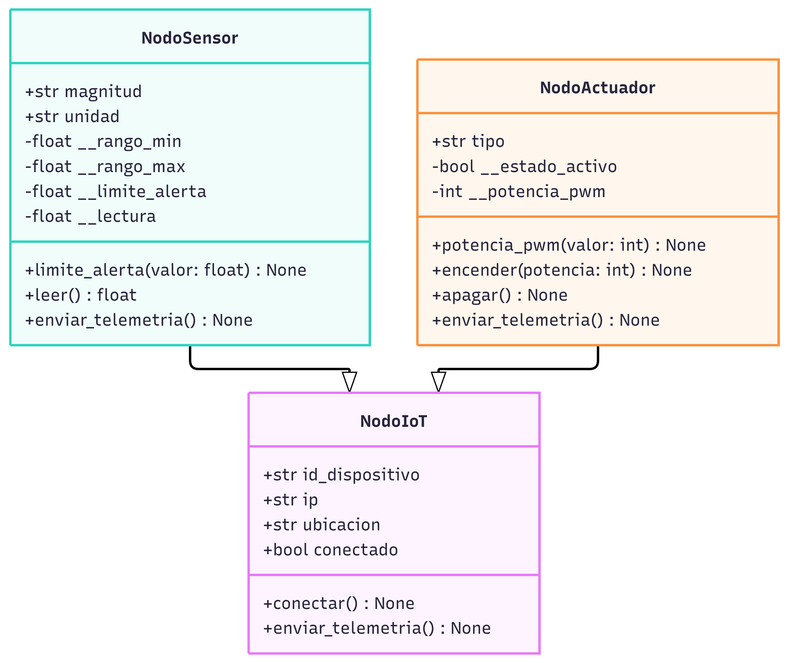

# 
## POO Red Sharks
## POO Red Sharks
## **Reporte de Práctica 2 de Laboratorio — Programación Orientada a Objetos**
### **EE: Temas Selectos de IIE II (Código: IEDI 18005)**
#### **Facultad de Instrumentación Electrónica — Universidad Veracruzana**

---

### **Información General del Equipo**

* **Práctica 2:** Sistema Modular de Nodos IoT (Herencia y Polimorfismo en Python)
* **Fecha de Entrega:** 07/11/2026
* **Enlace al Repositorio de GitHub:** https://github.com/julyhdez04/poo_red_sharks

| Nombre Completo del Integrante | Matrícula UV | Usuario de GitHub |
| :--- | :--- | :--- |
| **Castillo Acosta Josué Marcelo** | `S23013913` | [@Pinging78](https://github.com/Pinging78) |
| **Hernández Hernández Juliana** | `S23013963` | [@julyhdez04](https://github.com/julyhdez04) |
| **Gil Martínez Daniel Alberto** | `S23013953` | [@Mushi0w0](https://github.com/Mushi0w0) |
| **Navarro Hernández Hugo Jesús** | `S23013957` | [@Hiukilll](https://github.com/Hiukilll) |

---

## 1. Objetivos

* **Objetivo General:** Desarrollar un sistema modular de nodos IoT en Python empleando los pilares de la Programación Orientada a Objetos (herencia, polimorfismo y encapsulamiento) para simular la gestión y comunicación de múltiples dispositivos sin requerir hardware físico.

* **Objetivos Específicos:**
  * Diseñar una superclase base `NodoIoT` que centralice los atributos y comportamientos comunes de la red.
  * Implementar subclases especializadas (`NodoSensor` y `NodoActuador`) aplicando herencia y encapsulamiento riguroso para proteger los datos mediante métodos *setter* con validación.
  * Ejecutar un bucle polimórfico iterando sobre una colección heterogénea de objetos, logrando que el sistema identifique dinámicamente el comportamiento de cada dispositivo sin el uso de condicionales.

## 2. Desarrollo Ordenado por Módulos

### 2.1. Superclase Padre (`NodoIoT`)

En este módulo se definió la clase base fundamental para todos los dispositivos de la red. Se establecieron los atributos de instancia compartidos (`id_dispositivo`, `ip`, `ubicacion`, `conectado`) y se diseñaron los métodos base, estableciendo el contrato para las subclases.

**Archivo:** `src/nodo_iot.py`

```python
class NodoIoT:
    def __init__(self, id_dispositivo: str, ip: str, ubicacion: str):
        self.id_dispositivo = id_dispositivo
        self.ip = ip
        self.ubicacion = ubicacion
        self.conectado = False

    def conectar(self):
        self.conectado = True
        print(f"[{self.id_dispositivo}] Conectado exitosamente a la red ({self.ip}).")

    def enviar_telemetria(self):
        print(f"[{self.id_dispositivo}] Enviando telemetría de {self.ubicacion}...")
```

### 2.2. Subclases Hijas: Herencia y Encapsulamiento

**Herencia.** `NodoSensor` y `NodoActuador` heredan de `NodoIoT` y reutilizan su constructor mediante `super().__init__(id_dispositivo, ip, ubicacion)`. Gracias a esto no repiten los atributos compartidos ni el método `conectar()`.

**Encapsulamiento.** El estado sensible de cada subclase es privado (prefijo `__`) y solo se modifica a través de *setters* que validan el dato antes de aceptarlo:

| Clase | Atributo privado | Setter | Se rechaza con `TypeError` | Se rechaza con `ValueError` |
| :--- | :--- | :--- | :--- | :--- |
| `NodoSensor` | `__limite_alerta` | `limite_alerta` | Valores no numéricos, booleanos, `NaN` o infinito | Valores fuera de `rango_min`–`rango_max` |
| `NodoActuador` | `__potencia_pwm` | `potencia_pwm` | Valores no enteros o booleanos | Valores fuera de 0–100 |

El estado del actuador (`__estado_activo`) no tiene setter: solo cambia con `encender()` y `apagar()`.

**Polimorfismo.** Cada subclase sobrescribe `enviar_telemetria()`: el sensor reporta su lectura simulada y avisa si supera el límite; el actuador reporta si está encendido (con su potencia) o apagado.

**Archivo:** `src/nodos_hijos.py`

```python
"""Subclases de NodoIoT: NodoSensor y NodoActuador."""

import math
import random

from nodo_iot import NodoIoT


def _es_numero(valor) -> bool:
    """True si es int o float real (no bool, no NaN, no infinito)."""
    return (isinstance(valor, (int, float))
            and not isinstance(valor, bool)
            and math.isfinite(valor))


class NodoSensor(NodoIoT):
    """Nodo que mide una magnitud física y avisa si supera su límite."""

    def __init__(self, id_dispositivo: str, ip: str, ubicacion: str,
                 magnitud: str, unidad: str, rango_min: float,
                 rango_max: float, limite_alerta: float):
        # Herencia: se reutiliza el constructor del padre.
        super().__init__(id_dispositivo, ip, ubicacion)

        if not (_es_numero(rango_min) and _es_numero(rango_max)):
            raise TypeError("El rango del sensor debe ser numérico.")
        if rango_min >= rango_max:
            raise ValueError("rango_min debe ser menor que rango_max.")

        self.magnitud = magnitud
        self.unidad = unidad
        self.__rango_min = float(rango_min)
        self.__rango_max = float(rango_max)
        self.__lectura = float(rango_min)
        self.__limite_alerta = float(rango_max)
        # Se asigna con el setter para validar también el valor inicial.
        self.limite_alerta = limite_alerta

    @property
    def limite_alerta(self) -> float:
        """GET del límite de alerta."""
        return self.__limite_alerta

    @limite_alerta.setter
    def limite_alerta(self, valor: float) -> None:
        """SET con validación: número dentro del rango real del sensor."""
        if not _es_numero(valor):
            raise TypeError("El límite de alerta debe ser un número válido.")
        if not self.__rango_min <= valor <= self.__rango_max:
            raise ValueError(
                f"Límite {valor} fuera del rango del sensor "
                f"({self.__rango_min} a {self.__rango_max} {self.unidad})."
            )
        self.__limite_alerta = float(valor)

    @property
    def lectura(self) -> float:
        return self.__lectura

    @property
    def rango_min(self) -> float:
        return self.__rango_min

    @property
    def rango_max(self) -> float:
        return self.__rango_max

    def leer(self) -> float:
        """Simula una medición dentro del rango del sensor."""
        self.__lectura = round(
            random.uniform(self.__rango_min, self.__rango_max), 1)
        return self.__lectura

    def enviar_telemetria(self) -> None:
        """Polimorfismo: un sensor reporta su lectura actual."""
        lectura = self.leer()
        aviso = "  [ALERTA: supera el límite]" if lectura > self.__limite_alerta else ""
        print(f"[{self.id_dispositivo}] {self.magnitud}: {lectura} {self.unidad} "
              f"(límite {self.__limite_alerta} {self.unidad}){aviso}")


class NodoActuador(NodoIoT):
    """Nodo que acciona un dispositivo (relé, motor, ventilador)."""

    def __init__(self, id_dispositivo: str, ip: str, ubicacion: str, tipo: str):
        # Herencia: se reutiliza el constructor del padre.
        super().__init__(id_dispositivo, ip, ubicacion)
        self.tipo = tipo
        self.__estado_activo = False
        self.__potencia_pwm = 0

    @property
    def potencia_pwm(self) -> int:
        """GET de la potencia PWM (%)."""
        return self.__potencia_pwm

    @potencia_pwm.setter
    def potencia_pwm(self, valor: int) -> None:
        """SET con validación: entero entre 0 y 100."""
        if isinstance(valor, bool) or not isinstance(valor, int):
            raise TypeError("La potencia PWM debe ser un número entero.")
        if not 0 <= valor <= 100:
            raise ValueError(f"Potencia {valor}% fuera de rango (0 a 100).")
        self.__potencia_pwm = valor

    @property
    def estado_activo(self) -> bool:
        """GET del estado. Solo cambia con encender() y apagar()."""
        return self.__estado_activo

    def encender(self, potencia: int = 100) -> None:
        # Se valida primero; si es inválida no cambia el estado.
        self.potencia_pwm = potencia
        self.__estado_activo = True
        print(f"[{self.id_dispositivo}] {self.tipo} encendido al "
              f"{self.__potencia_pwm}% de potencia.")

    def apagar(self) -> None:
        self.__estado_activo = False
        self.__potencia_pwm = 0
        print(f"[{self.id_dispositivo}] {self.tipo} apagado.")

    def enviar_telemetria(self) -> None:
        """Polimorfismo: un actuador reporta su estado."""
        if self.__estado_activo:
            print(f"[{self.id_dispositivo}] {self.tipo}: ENCENDIDO "
                  f"({self.__potencia_pwm}% PWM)")
        else:
            print(f"[{self.id_dispositivo}] {self.tipo}: APAGADO")
```

### 2.3. Bucle Polimórfico (Script Principal)

La orquestación del sistema se realiza iterando sobre la lista mixta `red_iot`. El método `enviar_telemetria()` se invoca de forma uniforme y el intérprete ejecuta la versión que corresponde a la clase de cada objeto:

```python
red_iot = [sensor_temp, actuador_ventilador, sensor_luz]

for dispositivo in red_iot:
    dispositivo.enviar_telemetria()
```

Los `if/elif` que aparecen en `main.py` dependen de la **opción del menú** elegida por el usuario, no del tipo de dispositivo: en ningún punto se pregunta si un objeto es sensor o actuador.

**Archivo:** `src/main.py`

```python
"""Script principal: simulación interactiva de la red IoT."""

from nodos_hijos import NodoSensor, NodoActuador


def pedir_numero(mensaje: str, tipo=float):
    try:
        return tipo(input(mensaje))
    except ValueError:
        print("  Entrada no válida: se esperaba un número.")
        return None


def elegir(diccionario: dict, etiqueta: str):
    print(f"  {etiqueta} disponibles: {', '.join(diccionario)}")
    return diccionario.get(input("  ID: ").strip())


def main() -> None:
    sensor_temp = NodoSensor("TEMP-01", "192.168.1.10", "Invernadero",
                             "Temperatura", "°C", -10, 60, 30)
    sensor_luz = NodoSensor("LUZ-01", "192.168.1.11", "Invernadero",
                            "Luz", "lux", 0, 1000, 800)
    actuador_ventilador = NodoActuador("VENT-01", "192.168.1.20", "Invernadero",
                                       "Ventilador")

    # Lista mixta: cada objeto responde según su propia clase (polimorfismo)
    red_iot = [sensor_temp, actuador_ventilador, sensor_luz]
    sensores = {"TEMP-01": sensor_temp, "LUZ-01": sensor_luz}
    actuadores = {"VENT-01": actuador_ventilador}

    menu = ("\n=== RED IoT - HMI ===\n"
            "1. Conectar todos los nodos\n"
            "2. Telemetría de toda la red\n"
            "3. Cambiar límite de alerta de un sensor\n"
            "4. Encender un actuador\n"
            "5. Apagar un actuador\n"
            "0. Salir")

    while True:
        print(menu)
        opcion = input("Opción: ").strip()

        if opcion == "1":
            for dispositivo in red_iot:
                dispositivo.conectar()
        elif opcion == "2":
            for dispositivo in red_iot:
                dispositivo.enviar_telemetria()
        elif opcion == "3":
            sensor = elegir(sensores, "Sensores")
            valor = pedir_numero("  Nuevo límite: ") if sensor else None
            if valor is not None:
                try:
                    sensor.limite_alerta = valor
                    print(f"  Límite actualizado a {sensor.limite_alerta}")
                except (ValueError, TypeError) as error:
                    print(f"  Rechazado: {error}")
            elif sensor is None:
                print("  ID no encontrado.")
        elif opcion == "4":
            actuador = elegir(actuadores, "Actuadores")
            if actuador is None:
                print("  ID no encontrado.")
                continue
            potencia = pedir_numero("  Potencia PWM (0-100): ", int)
            if potencia is not None:
                try:
                    actuador.encender(potencia)
                except (ValueError, TypeError) as error:
                    print(f"  Rechazado: {error}")
        elif opcion == "5":
            actuador = elegir(actuadores, "Actuadores")
            if actuador is not None:
                actuador.apagar()
            else:
                print("  ID no encontrado.")
        elif opcion == "0":
            print("Fin de la simulación.")
            break
        else:
            print("Opción no válida.")


if __name__ == "__main__":
    main()
```

### 2.4. Diagrama de Clases UML

El diseño estructural modela la herencia hacia la superclase `NodoIoT` (flechas con punta triangular hueca) e incluye las visibilidades (`+` público, `-` privado) y los tipos de datos de atributos, parámetros y retornos. Sirvió como mapa previo a la codificación.



## 3. Evidencias de Ejecución

> **Nota Técnica:** Conforme a la guía de la Práctica 2, esta iteración es 100% simulación de software en Python enfocada en POO. Las evidencias de protoboard y diagramas esquemáticos con microcontroladores se desarrollarán en la Práctica 3. A continuación se evidencia el funcionamiento del HMI (Human-Machine Interface) simulado en consola.

**Captura de Consola (Ejecución del HMI y Polimorfismo):**

<!-- Guarda las capturas en practica-02/docs/capturas/ y reemplaza cada línea PENDIENTE por:  -->

* **PENDIENTE — Figura 1:** Opción 1, conexión de los tres nodos.
* **PENDIENTE — Figura 2:** Opción 2, telemetría de la red (tres salidas distintas con el mismo método).
* **PENDIENTE — Figura 3:** Opción 3, cambio de límite de alerta aceptado.
* **PENDIENTE — Figura 4:** Opción 3, límite fuera de rango rechazado por el setter (por ejemplo, 500 en el sensor de temperatura).
* **PENDIENTE — Figura 5:** Opción 4, encendido del ventilador con potencia válida.
* **PENDIENTE — Figura 6:** Opción 4, potencia fuera de rango rechazada (por ejemplo, 150).
* **PENDIENTE — Figura 7:** Opción 5 y telemetría final con el ventilador apagado.


## 4. Análisis de Resultados (Discusión Técnica)

La ejecución del HMI confirma el comportamiento de los tres pilares. En cuanto a la **herencia**, la opción 1 conecta los tres nodos (dos sensores y un actuador) con el mismo método `conectar()` definido una sola vez en `NodoIoT`; las subclases solo agregan lo que las distingue (magnitud, unidad y rangos en el sensor; tipo, estado y potencia en el actuador).

El **encapsulamiento** se comprobó con datos inválidos: un límite de 500 para un sensor de −10 a 60 °C es rechazado por el setter con el mensaje de rango, una potencia de 150 % para el ventilador también se rechaza y el estado del objeto queda sin cambios. Una entrada no numérica es detenida antes, en la función `pedir_numero` del script principal. Además, leer directamente `sensor.__limite_alerta` desde fuera de la clase produce un `AttributeError`, por lo que el atributo solo es accesible mediante la propiedad `limite_alerta`.

El **polimorfismo** se observa en la opción 2: el ciclo `for` sobre `red_iot` invoca `enviar_telemetria()` y cada objeto responde según su clase (lectura con aviso de alerta para los sensores, estado y potencia para el actuador), sin condicionales por tipo. Las lecturas de los sensores son simuladas con valores aleatorios dentro de su rango, por lo que cambian en cada ejecución; en esta práctica no interviene hardware físico.

## 5. Conclusiones Críticas

* Durante esta práctica, comprobamos cómo la herencia nos permite centralizar el comportamiento de los dispositivos IoT. Reutilizar el constructor del padre con `super()` nos ahorró repetir variables en cada nuevo tipo de nodo.

* El reto principal y el mayor aprendizaje fue el polimorfismo. Al programar la simulación HMI en el archivo main, pudimos iterar una lista con objetos distintos sin usar un solo `if/else` para diferenciarlos, lo que hace el código mucho más limpio.

* El encapsulamiento con atributos privados y *setters* validados evita que los objetos queden en estados inválidos (por ejemplo, una potencia PWM de 150 %), y concentra las reglas en un solo lugar en lugar de repetirlas en cada parte del programa.

* También cabe recalcar que comenzar con el Diagrama UML fue clave para visualizar la jerarquía. La POO nos da las herramientas para modelar sistemas físicos (como actuadores y límites de alerta) en bloques de código modulares y seguros, sentando las bases para cuando integremos el hardware real.

## 6 Referencias Bibliográficas

* Python Software Foundation. (s. f.). *Built-in Functions: property*. Python 3 Documentation. https://docs.python.org/3/library/functions.html#property
* Python Software Foundation. (s. f.). *Built-in Functions: super*. Python 3 Documentation. https://docs.python.org/3/library/functions.html#super
* Python Software Foundation. (s. f.). *Classes*. The Python Tutorial. https://docs.python.org/3/tutorial/classes.html
* Material del curso, Práctica 2: Sistema Modular de Nodos IoT (Eminus, Universidad Veracruzana).