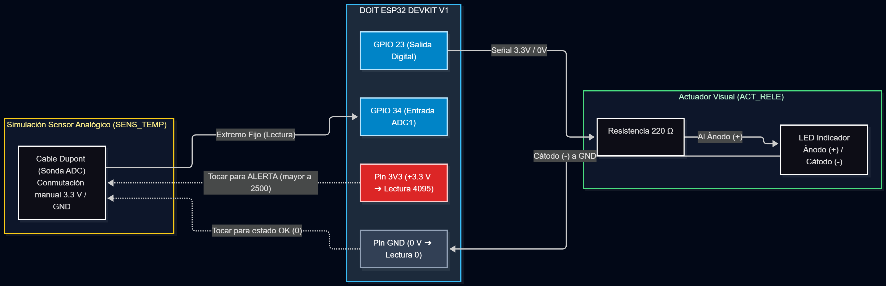

# POO Red Sharks — Universidad Veracruzana
## **Reporte de Práctica 3 — Programación Orientada a Objetos**
### **EE: Temas Selectos de IIE II (Código: IEDI 18005)**
#### **Facultad de Instrumentación Electrónica — Universidad Veracruzana**

---

### **Información General del Equipo**

*   **Número de Práctica:** Práctica 03
*   **Título de la Práctica:** Implementación Física de Nodos IoT Heterogéneos en C++ (ESP32)
*   **Fecha de Entrega:** 27/11/2026
*   **Enlace al Repositorio de GitHub:** <https://github.com/julyhdez04/poo_red_sharks.git>
*   **Ruta de Entrega en Repositorio:** `/practica-03/src/` y `/practica-03/docs/Reporte_Evidencias_P3.pdf`

| Nombre Completo del Integrante | Matrícula UV | Usuario de GitHub |
| :--- | :--- | :--- |
| Castillo Acosta Josué Marcelo | `S23013913` | @Pinging78 |
| Hernández Hernández Juliana | `S23013963` | @julyhdez04 |
| Gil Martínez Daniel Alberto | `S23013953` | @Mushi0w0 |
| Navarro Hernández Hugo Jesús | `S23013957` | @Hiukilll |

---

### **Sección 1: Mapeo de Abstracción (Hardware ➔ POO)**

El sistema implementado utiliza un microcontrolador **ESP32** programado en C++ bajo el paradigma de Programación Orientada a Objetos (POO). La arquitectura traslada la jerarquía diseñada previamente en Python a hardware físico real, integrando un **nodo sensor analógico** conectado al convertidor analógico-digital (ADC de 12 bits) y un **nodo actuador digital** que responde automáticamente cuando la lectura supera un umbral de alerta configurado.

Cada dispositivo físico se modela como una subclase que hereda de la superclase abstracta `NodoIoT`, permitiendo gestionar ambos componentes de manera uniforme mediante un arreglo polimórfico de punteros (`NodoIoT* red[2]`) en el ciclo principal del microcontrolador.

#### **1.1. Diagrama de Clases UML**

#### **1.2. Conexiones de Hardware (ESP32)**

| Componente Físico | Clase Asociada | Interfaz / Tipo | Pin ESP32 | Notas Técnicas |
| :--- | :--- | :--- | :--- | :--- |
| **Puente Dupont (Simulación de Sensor Analógico)** | `NodoSensorFisico` (`"SENS_TEMP"`) | Entrada Analógica (ADC1, 12 bits) | **GPIO 34** | Sonda con cable Dupont conmutada manualmente entre `GND` ($0\text{ V} \rightarrow 0$) y `3V3` ($3.3\text{ V} \rightarrow 4095$) para simular variaciones de señal analógica. |
| **LED Indicador + Resistencia $220\,\Omega$** | `NodoActuadorFisico` (`"ACT_RELE"`) | Salida Digital | **GPIO 23** | Conectado en serie a `GND`. Conmuta a `HIGH` ($3.3\text{ V}$) cuando la lectura en `GPIO 34` supera `_umbralAlerta` ($2500$). |

#### **1.3. Mapeo de Atributos (Características Físicas ➔ Variables de Clase)**

*   **Superclase `NodoIoT`** (atributos protegidos compartidos):
    *   `idDispositivo` (`String`): identificador único del nodo en la red (ej. `"SENS_TEMP"`, `"ACT_RELE"`).
    *   `pin` (`int`): número de terminal GPIO físico asignado en el ESP32.
    *   `conectado` (`bool`): bandera lógica que indica si el hardware ya fue inicializado mediante `iniciar()`.
*   **Subclase `NodoSensorFisico`**:
    *   `_umbralAlerta` (`int`, privado): valor límite dentro de la escala ADC del ESP32 ($0$ a $4095$, inicializado por defecto en $2048$ y configurado en $2500$ en `setup()`).
    *   `_ultimaLectura` (`int`, privado): almacena el último muestreo crudo obtenido por `analogRead(pin)`.
*   **Subclase `NodoActuadorFisico`**:
    *   `_estadoActivo` (`bool`, privado): representa el estado lógico actual de la salida física (`true` = `HIGH`, `false` = `LOW`).
    *   `_sensor` (`const NodoSensorFisico*`, privado): puntero de solo lectura al nodo sensor del cual depende la activación automática del actuador.

#### **1.4. Mapeo de Métodos (Acciones del Hardware ➔ Funciones miembro)**

*   **Clase `NodoIoT`**:
    *   `iniciar()`: método virtual base que marca `conectado = true` y reporta el inicio del nodo por el Puerto Serie.
    *   `ejecutarAccion()`: método virtual puro (`= 0`) que obliga a cada subclase a implementar su propia rutina de lectura o actuación.
*   **Clase `NodoSensorFisico`**:
    *   `setUmbralAlerta(int umbral)`: método *setter* con validación de rango ($0 \le \text{umbral} \le 4095$) que protege la integridad del parámetro frente a valores fuera de la resolución del ADC.
    *   `iniciar()`: configura el terminal con `pinMode(pin, INPUT)` e invoca `NodoIoT::iniciar()`.
    *   `ejecutarAccion()`: ejecuta `analogRead(pin)`, evalúa `hayAlerta()` (`_ultimaLectura > _umbralAlerta`) e imprime el resultado por el Monitor Serie.
*   **Clase `NodoActuadorFisico`**:
    *   `vincularSensor(...)`: asocia una instancia de `NodoSensorFisico` para gobernar la respuesta del actuador.
    *   `iniciar()`: configura `pinMode(pin, OUTPUT)`, asegura un estado inicial seguro en `LOW` con `digitalWrite(pin, LOW)` e invoca `NodoIoT::iniciar()`.
    *   `ejecutarAccion()`: consulta `_sensor->hayAlerta()`, actualiza `_estadoActivo`, conmuta físicamente el pin con `digitalWrite()` y reporta el estado por el Puerto Serie.

#### **1.5. Ejecución Polimórfica y Salida del Monitor Serie (115200 baudios)**

En `main.cpp`, las instancias físicas se almacenan en el arreglo `NodoIoT* red[2]`. Durante `loop()`, el programa recorre el arreglo invocando `red[i]->ejecutarAccion()` cada $500\text{ ms}$ sin consultar el tipo concreto de cada objeto.

[AQUÍ VA LA FOTOGRAFÍA DE LA VISTA GENERAL DEL MONITOR SERIE]

---

### **Sección 2: El Registro de Errores ("Bug Log")**

| # | Falla Física o Lógica Detectada | Causa Raíz (Hardware / Software) | Solución Técnica Implementada en Código / Conexión |
| :--- | :--- | :--- | :--- |
| **1** | Lecturas fluctuantes en el Monitor Serie al desconectar momentáneamente el puente Dupont de `GND` o `3V3`. | El GPIO 34 del ESP32 es de alta impedancia y no cuenta con resistencias pull-up/pull-down internas; al quedar el cable Dupont al aire durante el cambio de referencia, capta ruido electromagnético ambiental. | Se aseguró la conexión firme del cable Dupont directamente hacia el pin `GND` (lectura estable en $0$) o hacia el pin `3V3` (lectura estable en $4095$) durante las pruebas de validación. |
| **2** | Riesgo de configurar umbrales incompatibles con el convertidor ADC del ESP32. | A diferencia de placas Arduino de 10 bits ($0$–$1023$), el ADC del ESP32 opera a 12 bits ($0$–$4095$); un umbral fuera de ese rango impediría disparar o apagar la alerta. | Se encapsuló `_umbralAlerta` como `private` y se implementó validación estricta en `setUmbralAlerta()` rechazando valores menores a $0$ o mayores a $4095$. |
| **3** | Posible activación accidental del actuador al encender o reiniciar el microcontrolador. | Durante el arranque, el estado de salida de un pin recién configurado puede quedar indefinido hasta recibir la primera instrucción. | En `NodoActuadorFisico::iniciar()` se forzó explícitamente `digitalWrite(pin, LOW)` inmediatamente después de `pinMode(pin, OUTPUT)`. |

---

### **Sección 3: Justificación del Diseño Orientado a Objetos**

1.  **Herencia y Reutilización de Código:**
    *   *Respuesta:* La superclase abstracta `NodoIoT` centraliza los atributos comunes a cualquier dispositivo de borde (`idDispositivo`, `pin`, `conectado`) y el comportamiento base de inicialización (`iniciar()`). Tanto `NodoSensorFisico` como `NodoActuadorFisico` heredan de `NodoIoT` mediante listas de inicialización, evitando duplicar la gestión de identificadores, pines y trazas iniciales en el Puerto Serie.
2.  **Polimorfismo:**
    *   *Respuesta:* La clase base declara `virtual void ejecutarAccion() = 0` y un destructor virtual (`virtual ~NodoIoT()`). En `main.cpp`, el arreglo de punteros `NodoIoT* red[2]` almacena indistintamente un sensor y un actuador. Dentro de `loop()`, la llamada `red[i]->ejecutarAccion()` resuelve en tiempo de ejecución (enlace dinámico) la lectura analógica para `red[0]` y la conmutación digital para `red[1]`, sin emplear condicionales `if/else` ni conversiones de tipo.
3.  **Encapsulamiento y Ocultamiento de Datos:**
    *   *Respuesta:* Los atributos internos críticos (`_umbralAlerta` y `_ultimaLectura` en `NodoSensorFisico`; `_estadoActivo` y `_sensor` en `NodoActuadorFisico`) están declarados bajo visibilidad `private:`. Ninguna función externa puede alterar directamente la lectura almacenada ni asignar un umbral inválido, ya que toda modificación pasa por métodos controlados (`setUmbralAlerta()`, `vincularSensor()`, `setEstado()`).

---

### **Sección 4: Evidencias de Funcionamiento**

#### **4.1. Diagrama Esquemático de Conexiones del ESP32**

---

#### **4.2. Fotografías del Circuito Físico Armado en Protoboard**

> **[AQUÍ VA LA FOTOGRAFÍA DE LA VISTA GENERAL DEL CIRCUITO EN PROTOBOARD]**
>
``

> **[AQUÍ VA LA FOTOGRAFÍA DE LA PRUEBA EN TIEMPO REAL / ACTIVACIÓN DEL ACTUADOR]**

``

---

#### **4.3. Enlace Directo al Video Demostrativo (Máximo 3 minutos)**

[Ver video demostrativo en Google Drive](https://drive.google.com/drive/folders/11wjUm2c4MEMr-eYxtMajTkRcaawSgB9z?usp=sharing)