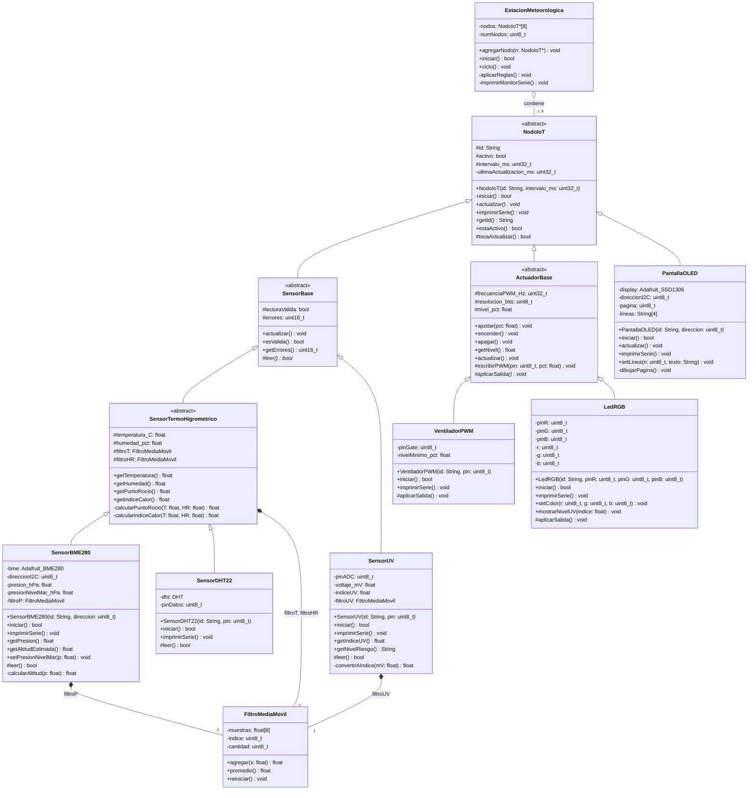
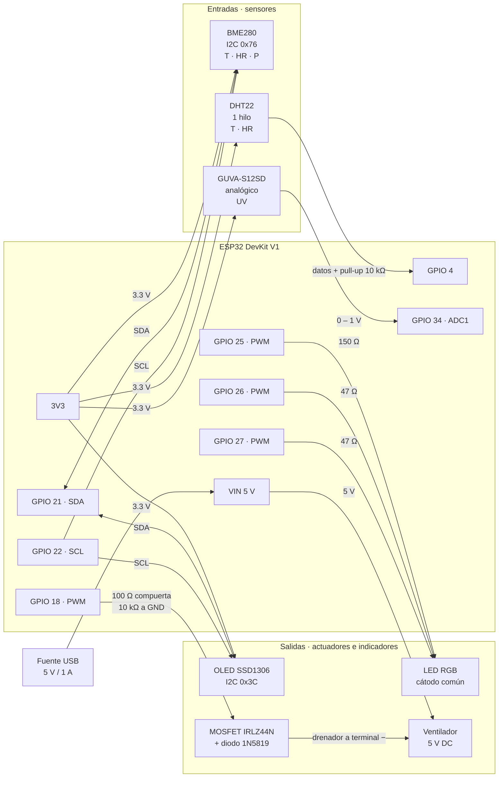

# Diagramas · Estación Meteorológica Automatizada

GitHub muestra los diagramas Mermaid como imagen.

---

## 1. Diagrama de clases UML

**Visibilidades:** `+` público · `-` privado · `#` protegido.
Los métodos en cursiva (marcados con `*` en el código Mermaid) son **abstractos**.

### Relaciones

| Símbolo | Relación | Ejemplo |
| :---: | :--- | :--- |
| `<\|--` (triángulo hueco) | **Herencia** ("es un") | `SensorBME280` es un `SensorTermoHigrometrico`, que es un `SensorBase`, que es un `NodoIoT` |
| `*--` (rombo relleno) | **Composición** | Cada sensor crea y destruye sus propios `FiltroMediaMovil` |
| `o--` (rombo hueco) | **Agregación** | `EstacionMeteorologica` agrupa los nodos, que existen por separado (se crean en `setup()`) |

---

## 2. Esquema de conexiones

### Diagrama de bloques

### Tabla de conexiones

| Componente | Terminal | Se conecta a | Notas |
| :--- | :--- | :--- | :--- |
| **BME280** | VCC / GND | 3V3 / GND | Usar el módulo de 3.3 V |
| | SDA / SCL | GPIO 21 / GPIO 22 | Comparte el bus I²C con la OLED |
| **OLED SSD1306** | VCC / GND | 3V3 / GND | |
| | SDA / SCL | GPIO 21 / GPIO 22 | Dirección `0x3C` (no choca con el BME280 en `0x76`) |
| **DHT22** | VCC / GND | 3V3 / GND | |
| | DATA | GPIO 4 | Pull-up de 10 kΩ a 3V3 (omitir si el módulo ya la tiene) |
| **GUVA-S12SD** | VCC / GND | 3V3 / GND | |
| | OUT | GPIO 34 | Solo entrada, ADC1. Atenuación 0 dB o 2.5 dB para tener más resolución en 0–1 V |
| **LED RGB** | R / G / B | GPIO 25 / 26 / 27 | Con resistencias en serie de 150 Ω (R), 47 Ω (G) y 47 Ω (B) |
| | Cátodo común | GND | |
| **MOSFET IRLZ44N** | Compuerta (G) | GPIO 18 | 100 Ω en serie y 10 kΩ de G a GND (evita que el ventilador arranque al encender) |
| | Fuente (S) | GND | |
| | Drenador (D) | Terminal − del ventilador | |
| **Ventilador 5 V** | Terminal + | VIN (5 V) | |
| | Terminal − | Drenador del MOSFET | Diodo 1N5819 en antiparalelo (cátodo a +5 V) y 100 µF entre 5 V y GND |

**Todas las tierras (GND) son comunes.**

### Pines que no se usan a propósito

- **GPIO 0, 2, 5, 12 y 15:** son pines de arranque (*strapping*) y pueden impedir que la placa inicie.
- **ADC2 (GPIO 25–27 como entrada analógica):** es menos confiable que ADC1 y deja de funcionar si se activa el WiFi. Por eso el sensor UV va en GPIO 34 (ADC1), y los GPIO 25–27 se usan solo como salidas PWM.
