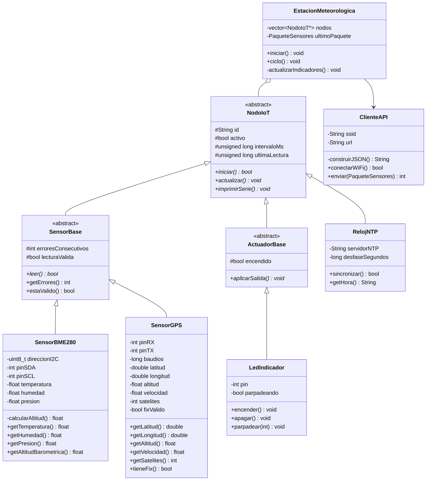
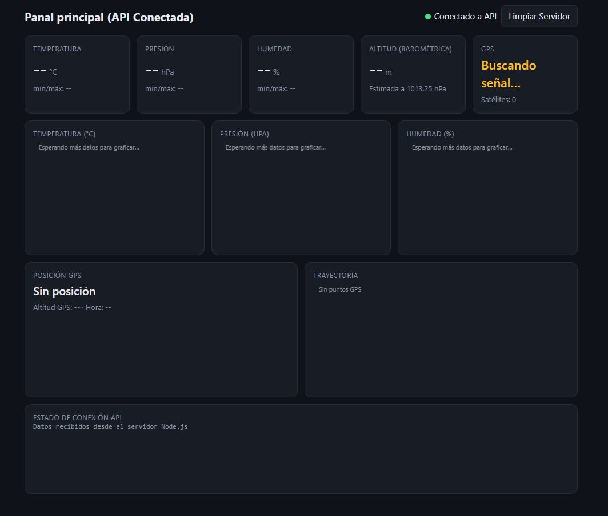
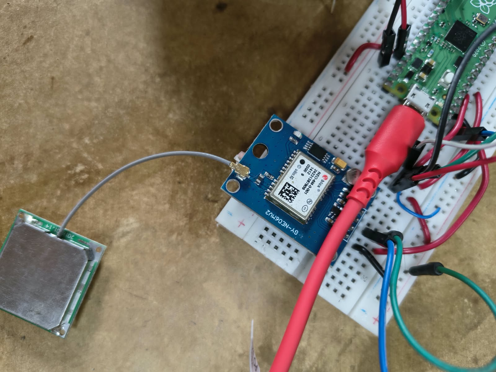
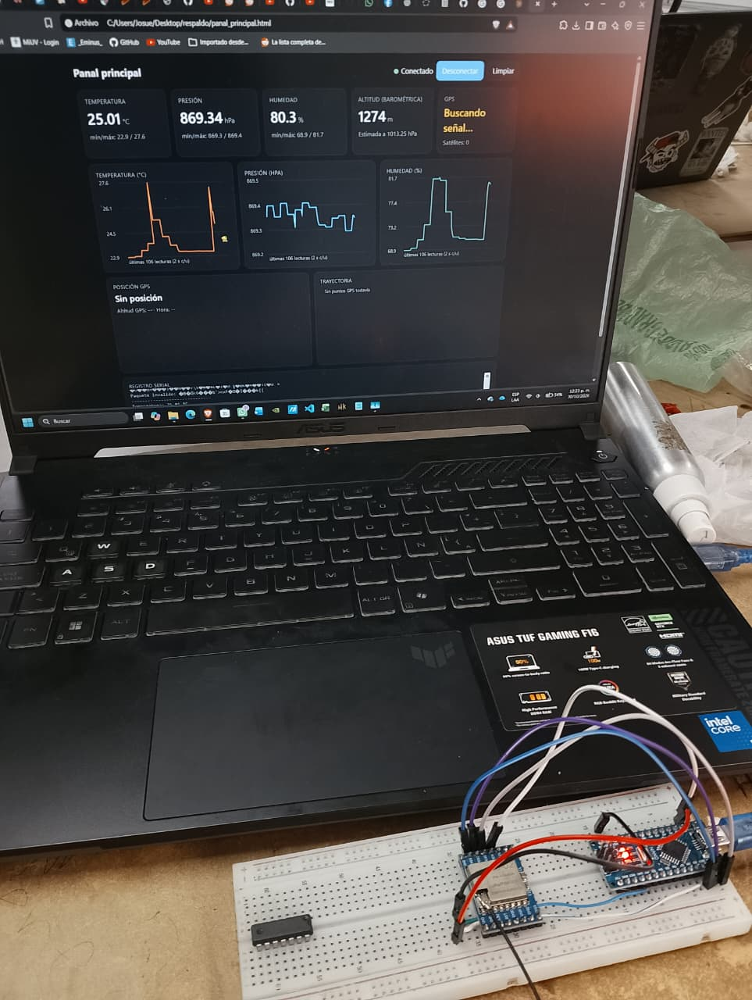

# POO Red Sharks — Universidad Veracruzana
## **Reporte del Proyecto Integrador — Programación Orientada a Objetos**
### **EE: Temas Selectos de IIE II (Código: IEDI 18005)**
#### **Facultad de Instrumentación Electrónica — Universidad Veracruzana**

---

### **Información General del Equipo**

*   **Número de Práctica / Etapa:** Proyecto Integrador — [Etapa 2]
*   **Título del Proyecto:** Estación Meteorológica Automatizada con Raspberry Pi Pico y API
*   **Fecha de Entrega:** 21/11/2026
*   **Enlace al Repositorio de GitHub:** <https://github.com/julyhdez04/poo_red_sharks.git>
*   **Repositorio de la API (servidor y panel):** <https://github.com/SNPAIX/API-SENSOR-UNAM.git>

| Nombre Completo del Integrante | Matrícula UV | Usuario de GitHub |
| :--- | :--- | :--- |
| Castillo Acosta Josué Marcelo | `S23013913` | @Pinging78 |
| Hernández Hernández Juliana | `S23013963` | @julyhdez04 |
| Gil Martínez Daniel Alberto | `S23013953` | @Mushi0w0 |
| Navarro Hernández Hugo Jesús | `S23013957` | @Hiukilll |

---

### **Sección 1: Mapeo de Abstracción (Hardware ➔ POO)**

La estación usa una **Raspberry Pi Pico** (microcontrolador RP2040) con dos sensores: un **BME280** (temperatura, humedad y presión) y un módulo GPS **NEO6VM2**. Dos LED, uno rojo y uno verde, indican si el GPS ya tiene posición válida. Cada 10 segundos la estación envía sus lecturas, en formato JSON, a la API del repositorio `API-SENSOR-UNAM`, que las guarda y las muestra en un panel web.

Cada componente se representa como una clase que hereda de la superclase abstracta `NodoIoT`.

> **Pendiente de confirmar:** la Raspberry Pi Pico estándar no trae WiFi. Para enviar datos a la API hace falta una **Pico W** o un módulo WiFi externo. Indicar aquí cuál se usó.

#### **1.1. Diagrama de Clases UML**



> Los nombres de las clases y los atributos siguen el diseño del proyecto y la estructura del repositorio de la API (estructuras `PaqueteSensores_t`, `PaqueteTiempo_t` y tareas `Sensores`, `TomarHora` y `Empaquetado`). Deben coincidir con el código final antes de entregar.

#### **1.2. Conexiones de Hardware (Raspberry Pi Pico)**

| Componente | Interfaz | Pines de la Pico | Notas |
| :--- | :--- | :--- | :--- |
| **BME280** | I²C0 (dirección `0x76`) | SDA = GP4 · SCL = GP5 | Alimentado a 3.3 V. Son los mismos pines que usa el repo de la API (`Wire.begin(4, 5)`). |
| **NEO6VM2** (GPS) | UART0, 9600 baudios | TX de la Pico = GP0 · RX de la Pico = GP1 | Cruzar TX con RX. El módulo acepta 3–5 V; los GPIO de la Pico son de 3.3 V. |
| **LED rojo** (220 Ω) | Digital | GP14 | Encendido o parpadeando: el GPS aún no tiene fix. |
| **LED verde** (220 Ω) | Digital | GP15 | Encendido: el GPS tiene fix y entrega posición válida. |

*Los pines de los LED y del GPS son una propuesta. Ajustar si en el circuito armado son otros.*

#### **1.3. Mapeo de Atributos (Características Físicas ➔ Variables de Clase)**

*   **Clase `SensorBME280`** (temperatura, humedad y presión por I²C):
    *   `direccionI2C` (`0x76`), `pinSDA` (GP4) y `pinSCL` (GP5): dirección del chip y pines del bus I²C al que está conectado. El chip se alimenta con 1.71 a 3.6 V.
    *   `temperatura`, `humedad`, `presion`: valores que entrega el sensor. La presión se guarda en hPa (el sensor la entrega en Pa y se divide entre 100). Precisión típica: ±0.5 °C, ±3 % HR y ±1 hPa.
    *   `calcularAltitud()` (privado): altitud barométrica estimada a partir de la presión, con 1013.25 hPa como presión de referencia al nivel del mar. Es el mismo criterio que usa el panel de la API.
*   **Clase `SensorGPS`** (módulo NEO6VM2, receptor tipo NEO-6M de u-blox):
    *   `pinRX`, `pinTX` y `baudios` (9600): parámetros del puerto serie por el que el módulo envía sus sentencias NMEA.
    *   `latitud`, `longitud`, `altitud`, `velocidad`: posición, altura sobre el nivel del mar y velocidad (km/h) decodificadas de las sentencias NMEA.
    *   `satelites` y `fixValido`: indican si el receptor ya tiene posición válida. Se usan para el LED rojo o el verde y para el campo `gps.fix` del JSON.
*   **Clase `LedIndicador`** (LED rojo y LED verde):
    *   `pin`: pin digital de la Pico conectado al LED, a través de una resistencia de 220 Ω.
    *   `encendido` y `parpadeando`: estado actual del LED.
*   **Clase `RelojNTP`**:
    *   `servidorNTP` (`pool.ntp.org`) y `desfaseSegundos` (−21600, o sea UTC−6): servidor y huso horario con los que se obtiene la hora local que se envía a la API.
*   **Clase `ClienteAPI`**:
    *   `ssid` y `url`: red WiFi y dirección del servidor (`http://132.248.26.212/api/sensores`) a donde se envían los datos.

#### **1.4. Mapeo de Métodos (Acciones del Hardware ➔ Funciones miembro)**

*   **Clase `NodoIoT`** (interfaz común):
    *   `iniciar()`: configura el hardware de ese componente (bus, puerto serie, pin o conexión).
    *   `actualizar()`: se llama en cada vuelta del ciclo principal. Lee o actúa cuando se cumple el intervalo, sin usar `delay()`.
    *   `imprimirSerie()`: envía al Monitor Serie (115200 baudios) el estado del objeto.
*   **Clase `SensorBME280`**:
    *   `iniciar()`: abre el bus I²C en GP4/GP5 y comprueba que el chip responda en `0x76`. Si no responde, lo reporta por el Monitor Serie.
    *   `leer()`: pide temperatura, humedad y presión al sensor y marca la lectura como válida o suma un error.
*   **Clase `SensorGPS`**:
    *   `iniciar()`: abre el UART0 a 9600 baudios.
    *   `leer()`: pasa los bytes recibidos al decodificador NMEA y actualiza posición, altitud, velocidad, satélites y estado del fix.
    *   `tieneFix()`: indica si la posición es válida, es decir, si el GPS ya está calibrado.
*   **Clase `LedIndicador`**:
    *   `encender()`, `apagar()`, `parpadear()`: activan o desactivan físicamente el pin del LED.
*   **Clase `EstacionMeteorologica`**:
    *   `actualizarIndicadores()`: enciende el LED verde y apaga el rojo si `tieneFix()` es verdadero; en caso contrario hace parpadear el rojo y apaga el verde.

#### **1.5. Integración con la API**

La estación envía sus datos a la API del repositorio `API-SENSOR-UNAM` (servidor Node.js con Express) cada 10 segundos.

| Elemento | Descripción |
| :--- | :--- |
| `POST /api/sensores` | Recibe el JSON de la estación. El servidor guarda el último dato y un historial de hasta 120 lecturas, y agrega los puntos con fix a la trayectoria. |
| `GET /api/sensores` | Entrega al panel web los datos guardados. El panel (`index.html`) los consulta cada 10 s. |
| `POST /api/limpiar` | Borra el historial y la trayectoria. |

Formato del JSON que arma `ClienteAPI.construirJSON()`:

```json
{
  "t": 24.80,
  "p": 848.60,
  "h": 61.20,
  "gps": {
    "fix": true,
    "lat": 19.543210,
    "lon": -96.910000,
    "alt": 1428.00,
    "sats": 7,
    "hora": "16:12:30"
  }
}
```

Los campos `t`, `p` y `h` salen de `SensorBME280` (°C, hPa y %). El bloque `gps` sale de `SensorGPS`, y `hora` sale de `RelojNTP`.

---

### **Sección 2: El Registro de Errores ("Bug Log")**
 
| # | Falla Física o Lógica Detectada | Causa Raíz (Hardware / Software) | Solución Técnica Implementada en Código / Conexión |
| :--- | :--- | :--- | :--- |
| **1** | Problemas en las conexiones: el BME280 o el GPS dejaban de responder de forma intermitente o no entregaban datos al armar el circuito. | Falsos contactos en la protoboard y en los cables de conexión, y líneas TX/RX del GPS sin cruzar entre el módulo y la Pico. | Se revisaron y se aseguraron las conexiones, se cruzó TX con RX y se verificó la alimentación de 3.3 V y la tierra común. En el código, `iniciar()` comprueba que el BME280 responda en `0x76` y avisa por el Monitor Serie si no lo hace. |
| **2** | Calibración del GPS: el módulo encontraba satélites, pero no llegaba a calibrarse (no obtenía fix) y el LED verde no encendía. | El receptor necesita señal de al menos cuatro satélites con buena calidad para calcular la posición, y en el arranque en frío puede tardar desde decenas de segundos hasta varios minutos. Además, contar satélites no es lo mismo que tener posición válida. | `SensorGPS.tieneFix()` se basa en la validez de la posición decodificada, no en el número de satélites. El LED rojo parpadea mientras no hay fix y el verde enciende solo cuando la posición es válida. Se dio tiempo de arranque al módulo y se mejoró la ubicación de la antena. |
| **3** | A veces el GPS no encontraba ningún satélite. | La antena no tenía vista despejada al cielo (por ejemplo, en interiores), o el módulo no recibía bien la alimentación o la comunicación serial con la Pico. | Se probó con la antena cerca de una ventana o en exterior, se verificó la velocidad de 9600 baudios y se confirmó en el Monitor Serie que llegaban sentencias NMEA. El estado "sin satélites" se muestra con el LED rojo y el campo `sats` del JSON en 0. |
 
---

### **Sección 3: Justificación del Diseño Orientado a Objetos**

1.  **Herencia y Reutilización de Código:**
    *   *Respuesta:* Sí. La superclase abstracta es `NodoIoT`. De ella heredan `SensorBase`, `ActuadorBase` y `RelojNTP`. De `SensorBase` heredan `SensorBME280` y `SensorGPS`, y de `ActuadorBase` hereda `LedIndicador` (que se instancia dos veces, una para el LED rojo y otra para el verde). Las subclases reciben el identificador, el estado, el intervalo de actualización no bloqueante y, en los sensores, el conteo de errores y la validación de la lectura. Con herencia estas partes se escriben una sola vez. Sin ella habría que repetirlas en cada componente. Usar una sola clase `LedIndicador` para los dos LED evita duplicar código.

2.  **Polimorfismo:**
    *   *Respuesta:* El método `leer()` se redefine en cada sensor. En `SensorBME280` consulta el bus I²C y en `SensorGPS` decodifica sentencias NMEA recibidas por UART. `EstacionMeteorologica` recorre un `vector<NodoIoT*>` y llama a `actualizar()` e `imprimirSerie()` sin saber qué componente es cada uno. Además, el BME280 y el GPS entregan altitud por principios distintos (presión barométrica y satélites), y ambos la exponen con un método del mismo tipo.

3.  **Encapsulamiento y Ocultamiento de Datos:**
    *   *Respuesta:* Los pines, la dirección I²C, los baudios y las credenciales WiFi son **privados** y se fijan en el constructor, para que ningún otro módulo los cambie por error. La fórmula de altitud (`calcularAltitud()`) y la construcción del JSON (`construirJSON()`) también son privadas. Las variables medidas son **protegidas** o privadas: las escribe la propia clase al leer, y el resto del programa solo las consulta con getters públicos (`getTemperatura()`, `getLatitud()`, `tieneFix()`, etc.). Así los datos crudos del sensor no se modifican desde fuera de su clase.

---

### **Sección 4: Evidencias de Funcionamiento (Validación Dual)**

#### **4.1. Captura de Pantalla de la API**




#### **4.2. Fotografía del Circuito Físico Armado (Garantía de Autoría)**





 
#### **4.3. Enlace Directo al Video Demostrativo (Máximo 1.5 minutos)**

*   **Enlace de Visualización:** [https://drive.google.com/drive/folders/1wsBi475p7gbk0lMJU0xp99_p8puwh9vw?usp=sharing]

